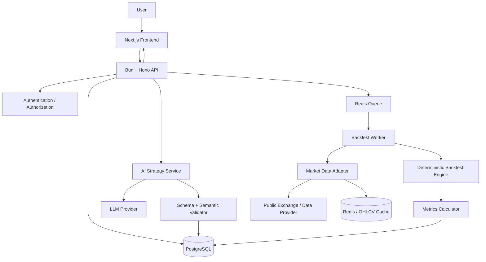
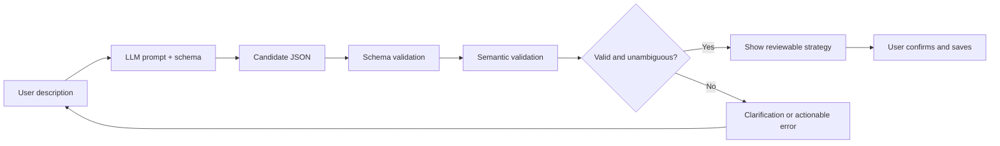

# Technical Specification (SPECS)

## AI Trading Strategy Lab

-   **Document status:** Draft v0.1
-   **Prepared:** 12 November 2026
-   **Related document:** `PRD.md`
-   **Architecture style:** Modular monolith + asynchronous backtest
    worker
-   **Execution mode:** Historical simulation only

---

## 1. Technical Objectives

The system must:

1.  Convert natural-language trading ideas into a restricted, versioned
    strategy specification.
2.  Validate generated strategies before they can be backtested.
3.  Retrieve, normalize, cache, and validate historical OHLCV data.
4.  Execute deterministic historical simulations asynchronously.
5.  Store immutable strategy versions and reproducible backtest
    metadata.
6.  Present results and assumptions in a way that users can understand.
7.  Support a workshop cohort without requiring exchange API
    credentials.

### Non-objectives

-   Live order execution.
-   Exchange account connectivity.
-   Arbitrary user code execution.
-   Derivatives, leverage, shorting, or liquidation simulation.
-   Distributed microservices or Kubernetes for the MVP.

---

## 2. Proposed Technology Stack

---

Layer Proposed technology Notes

---

Web frontend Next.js + TypeScript Responsive web
application

Styling Tailwind CSS Component system of
choice

Charts Lightweight Charts or Candlestick and equity
equivalent charts

Client data TanStack Query Server state and
caching

API Bun + Hono Modular HTTP API

Validation Zod Runtime validation

Database PostgreSQL Primary persistence

SQL layer Drizzle ORM / explicit Avoid unnecessary ORM
SQL complexity

Queue/cache Redis Backtest queue, cache,
rate limits

Worker Bun + TypeScript Separate
process/container

AI LLM API with structured Provider adapter
output

Market data CCXT-compatible Provider must be
provider or direct verified
public API

Deployment Docker + VPS/EC2 + Single-region initial
Nginx deployment

## CI/CD GitHub Actions Test, build, deploy

These are proposals, not provider commitments. Confirm current provider
capabilities, terms, data availability, and rate limits before
implementation.

---

## 3. High-Level Architecture



### Deployment units

For the MVP, deploy three logical units:

1.  **Web/API application:** Next.js frontend and Hono API. They may be
    separate processes or containers.
2.  **Backtest worker:** Separate process/container consuming jobs from
    Redis.
3.  **Data services:** PostgreSQL and Redis.

Do not introduce microservices for each module. Keep domain modules in
one backend codebase and extract services only when scale or operational
needs justify it.

---

## 4. Suggested Repository Structure

```text
ai-trading-strategy-lab/
├── apps/
│   ├── web/                     # Next.js frontend
│   ├── api/                     # Bun + Hono API
│   └── worker/                  # Backtest worker process
├── packages/
│   ├── contracts/               # Shared API and domain schemas
│   ├── strategy-spec/            # StrategySpec types and validators
│   ├── strategy-compiler/       # Validated spec -> executable plan
│   ├── indicators/              # Pure indicator calculations
│   ├── backtest-engine/          # Deterministic simulation engine
│   ├── performance/              # Metrics calculations
│   ├── market-data/              # Provider adapters and normalization
│   └── config/                   # Shared configuration
├── infra/
│   ├── docker/
│   └── nginx/
├── docs/
│   ├── PRD.md
│   └── SPECS.md
├── tests/
│   ├── fixtures/
│   └── integration/
├── docker-compose.yml
└── README.md
```

A monorepo is a suggestion, not a requirement. Keep shared contracts and
engine logic independently testable.

---

## 5. Core Domain Model

### 5.1 Strategy lifecycle

```text
DRAFT
  -> GENERATED
  -> VALIDATED
  -> SAVED VERSION
  -> BACKTEST SUBMITTED
  -> BACKTEST COMPLETED | FAILED
  -> NEW VERSION / ITERATION
```

A strategy's editable draft is mutable. A saved strategy version is
immutable.

### 5.2 StrategySpec v1

The StrategySpec is the canonical, versioned contract between the AI
layer, editor, validator, compiler, and backtesting engine.

Example (illustrative):

```json
{
  "schemaVersion": "1.0",
  "name": "BTC EMA Crossover",
  "description": "Enter on bullish EMA crossover and exit on bearish crossover.",
  "market": {
    "venue": "binance",
    "marketType": "spot",
    "symbol": "BTC/USDT",
    "timeframe": "1h"
  },
  "indicators": [
    {
      "id": "ema_fast",
      "type": "ema",
      "source": "close",
      "period": 20
    },
    {
      "id": "ema_slow",
      "type": "ema",
      "source": "close",
      "period": 50
    }
  ],
  "entry": {
    "operator": "crosses_above",
    "left": { "indicator": "ema_fast" },
    "right": { "indicator": "ema_slow" }
  },
  "exit": {
    "operator": "crosses_below",
    "left": { "indicator": "ema_fast" },
    "right": { "indicator": "ema_slow" }
  },
  "risk": {
    "positionSizing": {
      "type": "percent_equity",
      "value": 5
    },
    "stopLossPct": null,
    "takeProfitPct": null,
    "maxOpenPositions": 1
  }
}
```

The exact schema must be finalized before implementation and versioned
independently from application releases.

### 5.3 Supported v1 types

**Market** - `venue`: allowlisted provider identifier. - `marketType`:
`spot` only. - `symbol`: allowlisted symbol. - `timeframe`: initially
`1h` and `4h`.

**Indicators** - `ema` - `rsi`

**Price sources** - `open` - `high` - `low` - `close`

**Condition operators** - `greater_than` - `less_than` -
`crosses_above` - `crosses_below`

**Condition operands** - Price field. - Indicator reference. - Numeric
constant.

**Condition composition** - `all` (AND) - `any` (OR)

**Position sizing** - `percent_equity` - A fixed percentage of current
simulated equity.

**Risk** - Optional stop-loss percentage. - Optional take-profit
percentage. - Maximum open positions (v1 should be 1).

Unsupported constructs must fail validation rather than being silently
approximated.

---

## 6. AI Strategy Generation

### 6.1 Responsibilities

The AI service: - Accepts a user description and selected market
context. - Extracts intended entry, exit, indicators, and risk rules. -
Asks clarification questions when essential information is missing. -
Produces a StrategySpec candidate. - Explains the resulting rules in
plain language.

The AI service must not: - Execute trades. - Fetch or decide to use
arbitrary tools without server policy. - Generate executable Python or
JavaScript for the MVP. - Invent unspecified strategy parameters without
marking them as proposed assumptions. - Bypass validation.

### 6.2 Generation pipeline



### 6.3 Validation layers

**Syntactic validation** - Required fields exist. - Types and enums are
valid. - Numeric values are within configured bounds. - JSON conforms to
the StrategySpec version.

**Semantic validation** - Indicator IDs referenced by conditions
exist. - Indicator periods are supported. - Fast EMA period is less than
slow EMA period where required by the template. - Thresholds are in
valid ranges (e.g. RSI 0--100). - Timeframe and symbol are
allowlisted. - Entry and exit conditions are structurally executable. -
Risk parameters are valid. - No unsupported market or order behavior is
present.

**User confirmation** - Display entry and exit rules in natural
language. - Highlight assumptions and defaults. - Require confirmation
before saving a version or submitting a backtest.

### 6.4 Prompt-injection and untrusted input

-   Treat user descriptions as data, not system instructions.
-   Do not expose secrets or internal prompts.
-   Do not allow the model to select arbitrary endpoints or execute
    code.
-   Validate all model output server-side.
-   Enforce request and token limits.
-   Log provider/model/version and schema version, but avoid retaining
    unnecessary sensitive user text.

### 6.5 Provider abstraction

Define an internal interface such as:

```typescript
interface StrategyGenerationProvider {
  generate(input: StrategyGenerationInput): Promise<StrategyGenerationResult>;
}
```

This prevents the application domain from depending directly on one LLM
vendor.

---

## 7. Market Data

### 7.1 Canonical candle format

```typescript
type Candle = {
  venue: string;
  symbol: string;
  timeframe: string;
  timestamp: number; // Unix milliseconds, candle open time UTC
  open: number;
  high: number;
  low: number;
  close: number;
  volume: number;
};
```

Use UTC timestamps and a single documented candle timestamp convention
(open time).

### 7.2 Provider adapter

```typescript
interface MarketDataProvider {
  getCandles(input: {
    venue: string;
    symbol: string;
    timeframe: string;
    from: Date;
    to: Date;
  }): Promise<Candle[]>;
}
```

### 7.3 Data validation

Reject or flag: - Duplicate timestamps. - Non-monotonic candle
sequences. - Invalid OHLC relationships. - Negative volume where not
valid for the source. - Missing intervals. - Unexpected symbol/timeframe
responses. - Candles outside requested time range.

Do not silently fill missing candles with invented prices. The backtest
must either fail, or apply a documented gap policy and expose it in the
result metadata.

### 7.4 Caching

-   Cache normalized OHLCV by venue, symbol, timeframe, and time
    range/chunk.
-   Use bounded cache retention.
-   Avoid repeated provider requests for the same historical range.
-   Respect provider rate limits and terms.
-   Store a data-source identifier and data retrieval timestamp with
    each backtest.

For reproducibility, consider persisting the exact data snapshot or a
stable data manifest/hash for each backtest. A hash alone cannot
reproduce data if the source later revises or removes it.

---

## 8. Backtesting Engine

### 8.1 Execution model

The engine must be deterministic and independent from the LLM.

Input: - Immutable StrategySpec version. - Historical candle series. -
Backtest configuration. - Engine version.

Output: - Backtest status. - Performance metrics. - Equity curve
points. - Simulated trades. - Warnings and reproducibility metadata.

### 8.2 Backtest configuration

```typescript
type BacktestConfig = {
  initialCapital: number;
  startTime: string;
  endTime: string;
  feeRateBps: number;
  slippageBps: number;
  executionTiming: "next_candle_open";
};
```

Initial capital currency must match the quote currency for the selected
market (e.g. USDT for BTC/USDT).

### 8.3 Simulation rules

For v1, use a simple long-only spot model:

1.  Process candles in chronological order.
2.  Calculate indicators using only current and prior data.
3.  Evaluate signals after a candle closes.
4.  If a new entry signal occurs, simulate execution at the next candle
    open, adjusted for slippage.
5.  If an exit signal occurs, simulate exit at the next candle open,
    adjusted for slippage.
6.  Apply fees to executed notional.
7.  Prevent overlapping positions if `maxOpenPositions` is 1.
8.  Record every simulated order/fill and resulting position state.
9.  Mark equity consistently using a documented mark-to-market method.
10. Never use future candles to determine a current signal or fill.

Stop-loss/take-profit handling requires a separate, explicit intrabar
policy because OHLC candles do not reveal the sequence of high and low.
If both stop and target are touched within one candle, v1 must apply a
conservative documented rule or exclude the feature until a reliable
policy is implemented.

### 8.4 Indicator correctness

-   Indicator calculations must be pure functions.
-   Define warm-up behavior and null/insufficient-history handling.
-   EMA initialization method must be fixed and tested.
-   RSI smoothing method must be fixed and tested (e.g. Wilder's
    smoothing).
-   Cross detection must compare the previous and current completed
    values.
-   No signal may be generated until all required indicators are warmed
    up.

### 8.5 Fees and slippage

-   Fee rate is a configurable basis-point value.
-   Slippage is a configurable basis-point assumption.
-   Apply costs consistently to entry and exit fills.
-   Show the assumptions in the result.
-   Do not label a simulation as realistic execution; it is an
    approximation.

### 8.6 Required output

```typescript
type BacktestSummary = {
  initialCapital: number;
  endingEquity: number;
  netReturnPct: number;
  maxDrawdownPct: number;
  winRatePct: number;
  totalTrades: number;
  profitFactor: number | null;
  averageTradeReturnPct: number | null;
};
```

Also persist: - Equity curve. - Closed trade records. - Warnings. - Data
range and source. - Strategy version ID. - Strategy schema version. -
Backtest engine version. - Backtest configuration. - Creation and
completion timestamps.

Metric definitions must be documented and tested. For example: - Win
rate = profitable closed trades / all closed trades. - Profit factor =
gross profit / absolute gross loss; null if gross loss is zero. -
Maximum drawdown = maximum peak-to-trough decline in the equity curve. -
Net return = ending equity / initial capital - 1.

---

## 9. Asynchronous Job Processing

Backtests can be CPU- and data-intensive. Do not run them synchronously
inside a normal API request.

### Job lifecycle

```text
QUEUED -> RUNNING -> COMPLETED
                  -> FAILED
                  -> CANCELLED (optional)
```

### API behavior

-   API validates user ownership, strategy version, and configuration.
-   API creates a backtest job and enqueues its identifier.
-   API returns `202 Accepted` with the job ID.
-   Frontend polls a status endpoint or uses server-sent events.
-   Worker claims and processes the job.
-   Worker persists results and final status.
-   Failed jobs store a safe, user-readable error and an internal
    diagnostic reference.

### Reliability

-   Jobs must be idempotent or protected against duplicate processing.
-   Add retry policy only for transient failures.
-   Do not retry deterministic invalid-strategy failures.
-   Limit concurrent jobs per user and globally.
-   Set maximum date range, candle count, and execution time.
-   Worker must handle shutdown gracefully.

---

## 10. API Design

Base path: `/api/v1`

Authentication mechanism is an implementation decision. All protected
routes must derive the user identity from a verified server-side
session/token.

### Strategies

---

Method Endpoint Purpose

---

POST `/strategies/generate` Generate candidate
StrategySpec from
natural language

POST `/strategies` Create a strategy

GET `/strategies` List current user's
strategies

GET `/strategies/:strategyId` Get a strategy and
versions

PATCH `/strategies/:strategyId` Update mutable
metadata/draft

POST `/strategies/:strategyId/versions` Save an immutable
version

GET `/strategies/:strategyId/versions/:versionId` Get a version

DELETE `/strategies/:strategyId` Archive/delete
according to retention
policy
-----------------------------------------------------------------------------------------------

### Backtests

Method Endpoint Purpose

---

POST `/backtests` Submit a backtest job
GET `/backtests/:backtestId` Get job status and summary
GET `/backtests/:backtestId/trades` Paginated simulated trades
GET `/backtests/:backtestId/equity-curve` Equity curve data
GET `/strategies/:strategyId/backtests` List strategy backtests

### Market data

Method Endpoint Purpose

---

GET `/market-data/symbols` List supported symbols
GET `/market-data/timeframes` List supported timeframes
GET `/market-data/availability` Check available date range

### API conventions

-   Use consistent JSON error envelopes.
-   Validate all inputs at the API boundary.
-   Use pagination for trades and strategy lists.
-   Enforce ownership on every resource lookup.
-   Add request IDs for support and diagnostics.
-   Apply rate limits to AI generation and backtest submission.

Example backtest submission:

```json
{
  "strategyVersionId": "version-id",
  "config": {
    "initialCapital": 10000,
    "startTime": "2025-01-01T00:00:00Z",
    "endTime": "2025-06-01T00:00:00Z",
    "feeRateBps": 10,
    "slippageBps": 5,
    "executionTiming": "next_candle_open"
  }
}
```

Example response:

```json
{
  "backtestId": "backtest-id",
  "status": "QUEUED"
}
```

---

## 11. Database Schema (Logical)

Use PostgreSQL. The following is a logical schema; exact SQL types,
indexes, constraints, and migration syntax are implementation details.

### `users`

-   `id` UUID primary key
-   `email` unique
-   `password_hash` or external auth subject
-   `created_at`
-   `updated_at`

### `strategies`

-   `id` UUID primary key
-   `user_id` UUID foreign key
-   `name`
-   `description`
-   `status` (active/archived)
-   `created_at`
-   `updated_at`

### `strategy_versions`

-   `id` UUID primary key
-   `strategy_id` UUID foreign key
-   `version_number` integer
-   `schema_version`
-   `spec_json` JSONB
-   `source_prompt` text (optional; apply retention/privacy policy)
-   `generation_provider` nullable
-   `generation_model` nullable
-   `created_at`
-   Unique (`strategy_id`, `version_number`)

### `backtest_jobs`

-   `id` UUID primary key
-   `user_id` UUID foreign key
-   `strategy_version_id` UUID foreign key
-   `status`
-   `config_json` JSONB
-   `engine_version`
-   `data_manifest_json` JSONB
-   `error_code` nullable
-   `error_message_safe` nullable
-   `created_at`
-   `started_at` nullable
-   `completed_at` nullable

### `backtest_results`

-   `id` UUID primary key
-   `backtest_job_id` UUID unique foreign key
-   `summary_json` JSONB
-   `warnings_json` JSONB
-   `created_at`

### `backtest_trades`

-   `id` UUID primary key
-   `backtest_job_id` UUID foreign key
-   `sequence_number`
-   `side`
-   `entry_time`
-   `exit_time`
-   `entry_price`
-   `exit_price`
-   `quantity`
-   `entry_fee`
-   `exit_fee`
-   `gross_pnl`
-   `net_pnl`
-   `return_pct`
-   Unique (`backtest_job_id`, `sequence_number`)

### `market_candles` (optional persistent cache)

-   `venue`
-   `symbol`
-   `timeframe`
-   `timestamp`
-   `open`
-   `high`
-   `low`
-   `close`
-   `volume`
-   Composite primary key (`venue`, `symbol`, `timeframe`, `timestamp`)

### Indexes

At minimum: - `strategies(user_id, updated_at)` -
`strategy_versions(strategy_id, version_number)` -
`backtest_jobs(user_id, created_at)` -
`backtest_jobs(status, created_at)` -
`backtest_trades(backtest_job_id, sequence_number)` -
`market_candles(venue, symbol, timeframe, timestamp)`

---

## 12. Security and Operational Requirements

### Security

-   Enforce user-level authorization server-side.
-   Hash passwords using a modern password hashing algorithm if managing
    passwords.
-   Use TLS in production.
-   Store secrets in environment/secret management, never in source
    control.
-   Validate and bound all user inputs.
-   Apply request size, rate, and job limits.
-   Do not accept or store exchange API keys in the MVP.
-   Avoid logging credentials, session tokens, or unnecessary personal
    data.
-   Restrict CORS and security headers appropriately.
-   Protect against cross-user IDOR and insecure direct object
    references.

### Resource controls

-   Maximum candles per backtest.
-   Maximum date range per supported timeframe.
-   Maximum concurrent jobs per user.
-   Global worker concurrency limit.
-   AI request rate limit and token budget.
-   API timeout and worker execution timeout.
-   Redis queue retention and failed-job handling.

Exact limits should be chosen after measuring the selected VPS and
provider limits.

### Observability

-   Structured application logs.
-   Request/correlation IDs.
-   Job lifecycle logs.
-   Worker failure metrics.
-   AI provider latency/error metrics.
-   Market-data provider error and rate-limit metrics.
-   Basic health/readiness endpoints.

Do not log full user prompts by default unless there is a documented
need and retention policy.

---

## 13. Testing Strategy

### Unit tests

-   StrategySpec schema validation.
-   Semantic validation.
-   EMA and RSI calculations.
-   Cross-above and cross-below conditions.
-   Position sizing.
-   Fee and slippage calculations.
-   P&L and performance metrics.
-   Candle validation and gap detection.

### Deterministic engine tests

Use small hand-authored candle fixtures with expected: - Indicator
values. - Entry and exit signals. - Fill timestamps and prices. -
Fees. - Trade P&L. - Equity curve. - Final metrics.

The same inputs must yield identical outputs.

### Integration tests

-   AI provider output passes through validators.
-   Market-data adapter normalizes provider responses.
-   API submits a job and worker completes it.
-   User cannot access another user's strategy or backtest.
-   Failed jobs produce safe error states.

### End-to-end tests

Test the complete flow:

1.  Register/login.
2.  Create strategy from a prompt.
3.  Review and edit generated rules.
4.  Save a version.
5.  Submit a backtest.
6.  Wait for completion.
7.  Inspect metrics and trades.
8.  Create a second version and compare results (if comparison UI is
    implemented).

### Manual usability tests

Test with 3--5 people who are not software engineers. Observe whether
they can: - Understand the strategy prompt. - Identify entry and exit
rules. - Correct an AI assumption. - Run a backtest. - Explain at least
the meaning of return and drawdown.

---

## 14. Performance and Capacity

Initial capacity should be modest and measured, not guessed.

Design requirements: - API requests should not wait for a full
backtest. - Backtest work must be bounded by candle count and runtime. -
Market data should be cached. - Trade history should be paginated. -
Equity curves should be downsampled for large ranges if necessary. -
Worker concurrency should be configurable. - A workshop load test should
simulate expected attendee concurrency plus headroom.

Do not optimize prematurely for millions of users. First ensure a small
cohort can use the product reliably.

---

## 15. Deployment

### Initial topology

```text
Internet
   |
 Nginx / TLS
   |
   +---- Web application
   |
   +---- Hono API
             |
             +---- PostgreSQL
             |
             +---- Redis
                       |
                  Backtest worker
```

### Environments

-   `local`: Docker Compose and local provider/test fixtures.
-   `staging`: production-like configuration for rehearsal.
-   `production`: workshop and early-user environment.

### Deployment requirements

-   Automated build and test pipeline.
-   Database migrations run in a controlled release step.
-   Backups enabled and restore process tested.
-   Health checks for API, database, Redis, and worker.
-   Rollback procedure documented.
-   Environment variables separated by environment.

---

## 16. Suggested Implementation Sequence

1.  Finalize StrategySpec v1 and test fixtures.
2.  Create monorepo or shared package structure.
3.  Implement PostgreSQL schema and migrations.
4.  Implement strategy CRUD and immutable versions.
5.  Implement market-data adapter and candle normalization.
6.  Implement indicator library with unit tests.
7.  Implement deterministic backtesting engine with fixtures.
8.  Implement async job queue and worker.
9.  Implement AI provider adapter and structured generation.
10. Implement semantic validation and clarification behavior.
11. Implement Strategy Builder UI.
12. Implement results dashboard and trade history.
13. Add authentication, authorization, rate limits, and resource limits.
14. Deploy staging and test with non-technical users.
15. Rehearse workshop and prepare fallback demo.

The exact order of UI and backend tasks can overlap, but the
StrategySpec contract and engine correctness should be established
early.

---

## 17. Acceptance Criteria

The MVP is technically acceptable when:

-   [ ] StrategySpec v1 is documented and schema-validated.
-   [ ] AI output cannot bypass schema or semantic validation.
-   [ ] Unsupported instructions result in clarification or a clear
        rejection.
-   [ ] A user can create and save immutable strategy versions.
-   [ ] Historical candles are normalized and validated.
-   [ ] EMA and RSI implementations pass reference tests.
-   [ ] Backtests process data chronologically without look-ahead.
-   [ ] Fees and slippage are applied consistently.
-   [ ] Identical inputs produce identical backtest outputs.
-   [ ] Backtests run asynchronously.
-   [ ] Results are tied to the exact strategy version, engine version,
        configuration, and data manifest.
-   [ ] Users cannot access another user's resources.
-   [ ] API keys for exchanges are not requested or stored.
-   [ ] Workshop users can complete the core workflow without writing
        code.
-   [ ] A tested fallback demonstration exists.

---

## 18. Future Architecture Evolution

Only after validating usage and demand should the system expand.

### Stage 1 --- Historical strategy lab

Current MVP: natural language, StrategySpec, historical data,
backtesting, analytics.

### Stage 2 --- Paper trading

Add real-time market data, simulated order state, strategy scheduler,
execution event log, and monitoring. Reuse StrategySpec and strategy
compiler.

### Stage 3 --- Live execution

Requires a separate security and operational design: - Exchange
credential encryption and scoped permissions. - No-withdrawal API key
guidance. - Secrets isolation. - Order reconciliation. - Idempotency and
duplicate-order prevention. - Kill switch and user-level risk limits. -
Rate-limit handling. - Monitoring and incident response. -
Legal/compliance review in target markets.

Live execution must not be enabled merely by adding an API key field to
the MVP.

---

## 19. Open Technical Decisions

---

Decision Proposed direction Status

---

Market data source CCXT-compatible Verify provider and
exchange adapter terms

Initial venue One spot exchange TBD

Initial symbols BTC/USDT, ETH/USDT Verify

Timeframes 1h, 4h Proposed

LLM provider/model Structured-output TBD
capable provider

Authentication Managed auth or secure TBD
session implementation

Queue library Redis-backed queue Verify compatibility
compatible with Bun  
runtime

Candle persistence PostgreSQL cache Decide based on volume
initially; Redis for  
hot cache

Backtest data Persist snapshot or Design before release
reproducibility robust data manifest

Hosting capacity VPS/EC2 Benchmark

## Workshop date/cohort Confirm with BlockDev TBD

---

## 20. Engineering Principles

1.  **Determinism over cleverness:** the backtest engine must be
    predictable and testable.
2.  **Structured contracts over generated code:** AI produces a
    constrained StrategySpec, never arbitrary executable code.
3.  **Transparency over impressive numbers:** every result exposes
    assumptions and limitations.
4.  **Immutable history:** a backtest always points to the exact
    strategy version it tested.
5.  **Modular monolith first:** keep the system simple until real load
    or team boundaries justify extraction.
6.  **Simulation before execution:** validate product value and safety
    before integrating real funds.
7.  **User comprehension is a feature:** non-technical users must
    understand what the system will simulate before they run it.
